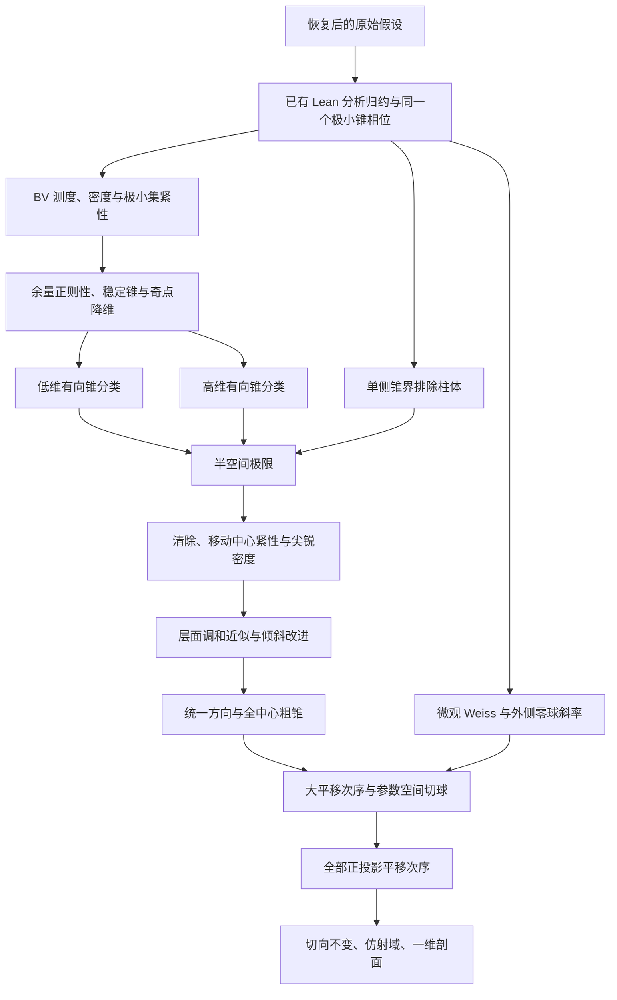

# 两个刚性定理：详细数学证明与形式化计划

本目录补全两个刚性目标剩余的几何基础和从平面极限返回原解的证明，使用已经找回的反应项假设。关键引理逐项展开，并经过交叉审查。它是一份自然语言数学证明，**不是 Lean 内核已经验证的证明**：两个刚性主定理仍有证明洞，完整 Comparator 和 Palomar 登记尚未完成。

先读 [两个主定理与完整证明链](theorems.md)，再查阅各编号引理。后续实现使用 [详细形式化计划](formalization-plan.md)，其中列出已有声明、建议模块、前驱、输入输出及验收条件。

## 阅读顺序

| 章节 | 内容 |
|---|---|
| [反应项与目标](reaction-and-targets.md) | 全部假设、零点非退化、势的延拓、剖面与目标坐标 |
| [BV 与极小集合](bv-minimizers.md) | 周长测度表示、密度、紧性、单调公式、良好柱图形 |
| [极小边界正则性](gmt-regularity.md) | 压平竞争者、调和高度、余量衰减、Simons 计算、奇点降维 |
| [低维分类](low-dimensional.md) | 环境维数二至八的有向极小锥分类 |
| [单侧界与高维分类](one-sided.md) | 单侧界传递、奇集截断、半空间或柱体、柱体排除 |
| [清除与界面位置](clearing-out.md) | 环带竞争者、微观非退化、两侧纯相、界面捕获 |
| [移动中心紧性](moving-center-compactness.md) | 任意序列恢复比较、极限极小性、统一动能质量 |
| [全中心尖锐界](sharp-density.md) | 一个平面极限给全中心锐能量界、所有后续极限仍为平面 |
| [具体平坦性估计](flatness-estimates.md) | 倾斜趋零、应力高度公式、稳定井尾部 |
| [调和近似](harmonic-approximation.md) | 实际好点投影、层面图、低尾部、强梯度收敛、倾斜改进 |
| [迭代与公共方向](iteration-and-directions.md) | 停止误差递推、跨尺度投影、跨中心公共法向 |
| [切球斜率](tangent-ball-comparison.md) | 含反应项的 Weiss 恒等式、半球等号、边界斜率、弱 Hopf |
| [全空间平移比较](distance-and-sliding.md) | 粗锥起滑、平移极限连通、次序集合切球、零接触排除 |
| [原解的最终识别](flatness-transfer.md) | 全方向次序到切向不变、仿射图形与一维剖面 |

所有公式使用 GitHub 可渲染的双美元分隔符。数学引理编号不表示相同名称的 Lean 声明已存在。

## 主证明依赖

DS4–DS6 另给出只用 C1 反应项的远井方向证明。最终的切球路线不依赖它，形式化主目标可先走较短的依赖链。

## 本轮审查修正的关键问题

- 良好水平集合采用实际好点的投影；坏点质量不被误用为整根坏柱的质量。
- 极限平面经过原点，先由局部常数相位排除证明，再使用界面捕获，避免循环。
- 核心压平、可逆环带和柱面拼接分别计算，不对非单射映射使用周长变换公式。
- 球与旋转柱体保留比例常数，迭代包含参数停止误差。
- 不提高 f 的正则性，也不假定平移极限边界光滑；零值接触由切球、Weiss 放大和显式 Hopf 屏障处理。

这些是数学审查。后续仍须逐个实现 Lean 接口并审计公理。一般实分析、Sobolev 理论、线性椭圆正则性和光滑微分几何基础的实施入口在计划 §7.1 明列；不能把文稿使用的基础定理误认为 mathlib 已经提供。
